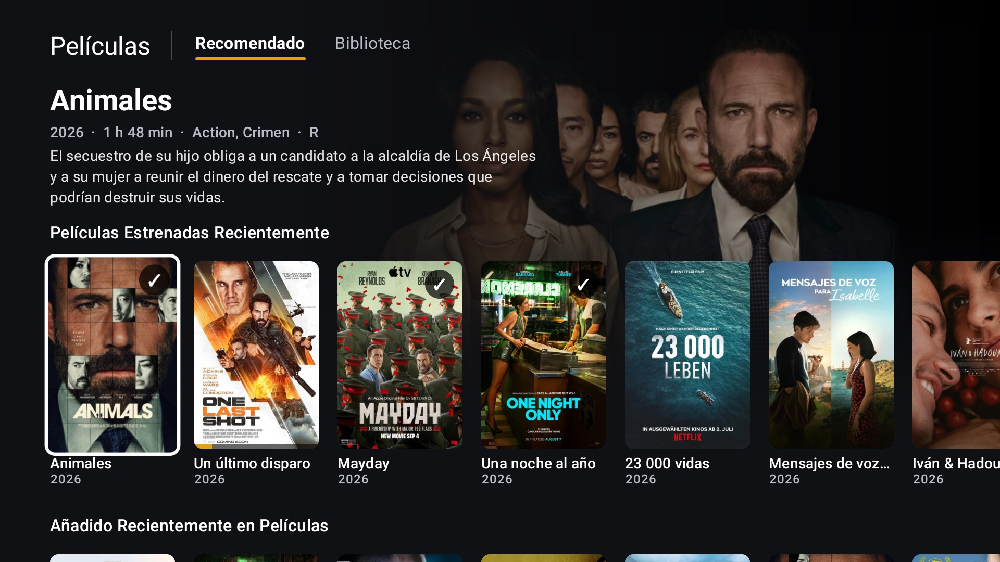
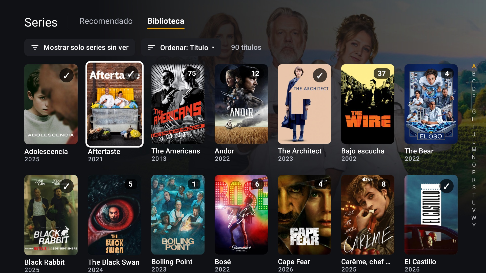

# PlexLite

A small, fast, unofficial [Plex](https://www.plex.tv/) client for Google TV and Android TV. It is a native app
built with Kotlin, Jetpack Compose for TV and Media3/ExoPlayer, with no web view. It tries hard to direct play.

> **Heads-up: this project is vibe-coded.** I wrote nearly all of it by talking to an AI coding assistant
> ([Claude Code](https://claude.com/claude-code)), testing every change on a real TV and saying what felt wrong.
> The goals were **simplicity** and **performance**: a client that keeps up with the remote and starts videos
> quickly, without trying to do everything the official app does.

*I use it every day on a TCL Google TV (Android TV 11, 32-bit ARM). The Plex server is on Unraid in another
city. PlexLite is not affiliated with Plex, Inc.*

## Why this exists

After Plex's redesign, the official app on my TV became slow. Scrolling stuttered. Videos buffered for a long
time before starting. Files that used to play directly started failing with "transcoding problems".

My server is hundreds of kilometres away, so every round trip costs time. A heavy, web-based UI makes that
worse. So I built a client that does less, quickly:

- **It draws native Compose UI** on the device and fetches no extra data while you move around.
- **It tells the server exactly what the TV can decode**, so the server stops transcoding without a reason.
- **When something fails, it tries the next option** instead of showing an error code.

## What it looks like

These are real captures from the TV, of my own library.


**Home**: the focused item drives the backdrop and the info block at the top. *Continue watching* comes first,
then the server's hubs, in your library order.



**Library, Recommended tab**: each library opens on its own shelves (recently released, recently added, …).
The library bar hides while you browse the content. Back brings it back.



**Library tab**: the full poster grid with an unwatched filter, a sort menu and an A–Z rail. Watched items get
a ✓, and shows get an unwatched-episodes count.


**Detail page**: IMDb / TMDB / Rotten Tomatoes ratings, resume or restart, mark as watched, quality, audio
and subtitle pickers, and cast.

## What it does

- **Direct play first.** At startup it detects the TV's hardware video decoders. It tells the server about
  every audio format ExoPlayer + FFmpeg can decode (AAC, AC3, E-AC3, DTS, TrueHD, FLAC, Opus…) and about
  SRT/ASS/PGS/VobSub subtitles.
- **A failover chain.** Version 1 direct → version 1 transcode → version 2 direct → … The friendly error
  panel only appears when every option has failed. Stale media versions whose files are missing are skipped
  (`checkFiles=1`).
- **Fast start.** There is no upfront speed test. Playback starts at ~1.5 s buffered and keeps loading up
  to 2 minutes ahead.
- **Connection racing.** It probes every server connection in parallel and keeps the best one. The Plex relay
  is a last resort.
- **A player built for a remote.** Controls stay hidden until you press OK. ←/→ seeks accumulate into one
  jump. Audio and subtitle menus. OpenSubtitles search through your server. Four subtitle sizes. Skip intro
  and skip credits. Next episode. Progress synced with Plex.
- **Plex Home.** A profile picker with avatars, PIN users and optional auto sign-in for the last user.
- **Your libraries, your order.** You can reorder and hide libraries, per user and per server. There is also
  search, without voice.
- **10 languages**: English, Spanish, French, German, Italian, Portuguese, Russian, Mandarin Chinese, Arabic
  (right-to-left) and Hindi.

## The honest scope

I built it for the way *I* watch:

- **Movies and TV shows only.** No music, photos, live TV, watchlist or Plex's online tabs.
- **Tested on one TV and one server.** The multi-server picker and PIN-protected users were never tested on
  real hardware. Expect bugs I haven't hit.
- **Sideload only.** It isn't on the Play Store.

If that fits you, it's very pleasant to use. If it doesn't, the official app will serve you better.

## Build

```sh
JAVA_HOME=/opt/homebrew/opt/openjdk@21 ./gradlew :app:assembleRelease
```

The APK is written to `app/build/outputs/apk/release/app-release.apk`. It is signed with the debug key for
sideloading.

Always install the **release** build on the TV. Compose debug builds are noticeably slower.

## Install on the TV

1. On the TV, open **Settings → System → About → OS build** and press it 7 times to enable developer options.
2. In **Settings → System → Developer options**, enable **USB debugging** (and **Wireless debugging** if your
   TV has it).
3. Connect from a computer on the same network:

```sh
ADB=/opt/homebrew/share/android-commandlinetools/platform-tools/adb
$ADB connect TV_IP:5555             # or: $ADB pair TV_IP:PAIRING_PORT, then connect
$ADB install -r app/build/outputs/apk/release/app-release.apk
```

The app shows up as **PlexLite** in the apps row. If something goes wrong, check the logs with
`$ADB logcat -s PlexLite:*` (tokens are redacted).

## Acknowledgements

- [GLinnik21/plx-native](https://github.com/GLinnik21/plx-native), a native Plex client for LG webOS, inspired
  this project. Its `docs/pms-api.md` is the best description of the real Plex Media Server API I have found.
  No code was copied: it is GPL-3.0 and webOS-specific, and it was used only as protocol documentation.
- The README layout borrows from plx-native and [Gathin23/cleanyourtv](https://github.com/Gathin23/cleanyourtv).
- [Jellyfin's Media3 FFmpeg decoder](https://github.com/jellyfin/jellyfin-androidx-media) plays the audio
  formats the TV can't decode by itself.

## Trademarks

PlexLite is an unofficial client. It is not affiliated with, endorsed by or sponsored by Plex, Inc. or Google.
"Plex", "Google TV", "Android TV", "IMDb", "TMDB" and "Rotten Tomatoes" are trademarks of their respective
owners. The posters and artwork in the screenshots belong to their rights holders.
